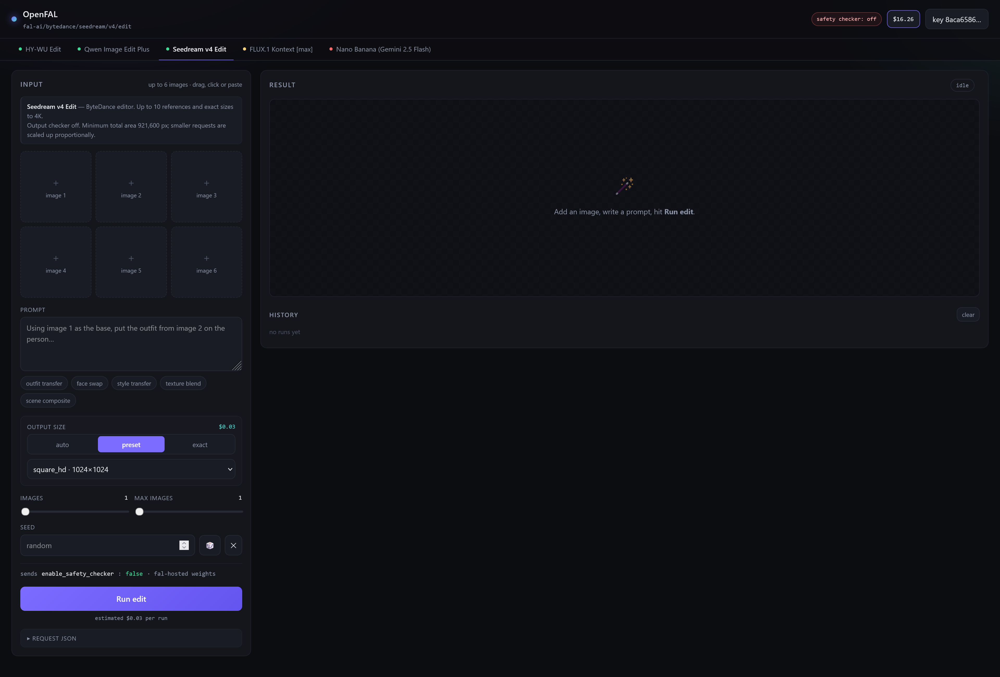

# OpenFAL

A local, self-hosted playground for [fal.ai](https://fal.ai) **image-editing** endpoints. One UI,
one tab per model, your API key held server-side and never exposed to the browser.

 



## Quick start

```bash
git clone https://github.com/<you>/OpenFAL.git
cd OpenFAL
npm install
cp .env.example .env      # then paste your key into FAL_KEY=
npm start
```

Open <http://localhost:5178>.

### Windows

Double-click `start.bat` to bring the server up and `stop.bat` to take it down.

`start.bat` launches the server **detached, with no console window** — it prints where things
went, then exits. Nothing has to stay open to keep the server running, and it survives closing
the window it was launched from. Because there is no console to print to, output goes to
`.srv.log` and `.srv.err` (both gitignored, and both truncated on each start).

| Command | What it does |
|---|---|
| `start.bat` | Starts in the background, waits for the port to answer, opens the browser |
| `start.bat -c` | Runs in the current window instead — closing it stops the server. For debugging |
| `stop.bat` | Stops the running server |

Both scripts resolve the port through `_port.bat`, the same way `server.js` does (`PORT` from the
environment, then `.env`, then 5178), and both check that the process holding the port is actually
`node.exe` before starting a duplicate or killing anything.

The server runs as your user, so it stops when you log out — this is a local playground, not a
service. If you want it back automatically, point a shortcut to `start.bat` from your Startup
folder (`shell:startup`).

No key in `.env`? The app shows a key field in the header; saving it writes `FAL_KEY` to `.env`
for next time. Either way the key stays on the server — the page only ever talks to localhost,
so it never appears in page source or in a request from the tab.

## Features

- **Six image-editing models and one reference-to-video model** behind tabs, each with its own schema, parameters and pricing
- **Reference slots** (1–9 depending on model) — drag, click, paste, or drop a URL. Image models take images; Wan 3.0 also takes video and audio clips
- **Exact output sizing** with input-relative scaling, a long-side cap and step snapping
- **Input aspect-ratio detection** for ratio-based models — reads image 1's real geometry and pins
  the dropdown to the closest supported ratio, instead of leaving the shape to `auto`
- **Live cost estimate** per run, and your fal **credit balance** in the header
- **Queue-based submission** so a slow generation survives a page reload, with live queue position and logs
- **Run history** (last 40) with one-click restore of a run's settings
- Results: zoom, download, save locally, or feed straight back in as input 1

## Models

| Tab | Endpoint | Refs | Output size | Safety parameter |
|---|---|---|---|---|
| HY-WU Edit | `fal-ai/hy-wu-edit` | 1–3 | auto / preset / exact* | `enable_safety_checker: false` |
| Qwen Image Edit Plus | `fal-ai/qwen-image-edit-plus` | 1–3 | preset / exact | `enable_safety_checker: false` |
| Seedream v4 Edit | `fal-ai/bytedance/seedream/v4/edit` | 1–6 | auto / preset / exact to 4K | `enable_safety_checker: false` |
| FLUX.1 Kontext [max] | `fal-ai/flux-pro/kontext/max` | 1 | aspect ratio | `safety_tolerance: 6` |
| Nano Banana (Gemini 2.5 Flash) | `fal-ai/gemini-25-flash-image/edit` | 1–3 | aspect ratio | `safety_tolerance: 6` |
| Nano Banana 2 (Gemini 3 Pro) | `fal-ai/nano-banana-2/edit` | 1–6† | aspect ratio × 1K/2K/4K | `safety_tolerance: "6"` |
| Wan 3.0 Reference-to-Video | `alibaba/wan-3.0/reference-to-video` | 0–9‡ images, videos, audio | aspect ratio × 480p/720p/1080p, 2–30 s | `enable_safety_checker: false`§ |

\* HY-WU normalises output to ~1 MP regardless of what you ask for — see [Findings](#findings).

† The endpoint accepts 14 references; the UI grid caps at 6.

‡ The endpoint accepts 10 images, 5 videos (15 s total, at least 16 fps) and 5 audio clips (15 s total);
the UI grid holds 9 of any mix. The prompt refers to them per type in slot order: "Image 1", "Video 1".
Output is billed at $0.05 / $0.10 / $0.20 per second for 480p / 720p / 1080p; reference video seconds
are billed on top at a rate fal does not publish, so the cost estimate leaves them out.

§ fal documents that disabling the checker "requires account authorization; unauthorized requests are
always checked." The flag is sent, but on an ordinary account it has no effect.

## Adding a model

Drop one file in `models/`. It is discovered at boot; nothing else references it by name.

```js
// models/my-editor.js
import { defineModel } from "./_schema.js";

export default defineModel({
  key: "my-editor",
  id: "fal-ai/some/edit-endpoint",
  label: "My Editor",
  order: 60,
  blurb: "One line shown on the tab tooltip.",
  docs: "https://fal.ai/models/fal-ai/some/edit-endpoint",
  hosting: "fal",                                              // "fal" | "partner"
  safety: { param: "enable_safety_checker", value: false, kind: "off" },
  note: "Shown in the panel under the tabs.",
  images: { min: 1, max: 3, field: "image_urls" },             // or field: "image_url"
  // optional: videos / audios take { max, field }, slots sets the grid size, output: "video"
  size: { kind: "dims", modes: ["auto", "preset", "custom"] }, // or kind: "aspect"
  params: ["steps", "guidance", "num_images", "output_format"],
  defaults: { steps: 40 },
  pricing: { perImage: 0.03 },                                 // or { mp: 0.10 }
});
```

The UI builds its controls from `params`, so a new model needs no HTML, CSS or server changes.
`defineModel` validates the definition at boot and throws a specific error if something is
missing or misspelled, rather than failing at submit time.

Need a control no model uses yet? Add one entry to `PARAMS` in `models/_schema.js` — it maps a
UI control type (`range` / `select` / `text` / `toggle`) to a fal payload field, and both the
server's payload builder and the browser's form renderer read from it.

## Output size

Segmented **auto / preset / exact** for dimension-based models; a ratio select for aspect-based ones.

| Control | What it does |
|---|---|
| `W × H` | Exact pixels. Typing switches off input-scaling. 🔗 holds aspect while typing, ⇄ swaps. |
| Scale from input image | W×H = image 1's real dimensions × 0.25–3×. `1:1` resets to native size. |
| cap `[long side ▾] [2048]` | Applied after scaling, aspect preserved. Long-side capping covers both orientations from one setting: 832×1216 @2× → 1408×2048, and 1920×1080 @2× → 2048×1152. |
| step `[16 ▾]` | Snaps both dimensions to a multiple of 8/16/32/64. |

Every dimension is re-clamped server-side to 256–4096 px (per-model maximum), so a bad value
cannot reach fal.

### Aspect-ratio models

Kontext, Nano Banana and Nano Banana 2 have no width/height fields at all — output shape is
whatever `aspect_ratio` says, so that one dropdown is the entire geometry control.

**Match input image** (on by default) measures image 1 in the browser and pins the dropdown to
the closest ratio the endpoint actually offers, compared in log space so `4:3` and `3:4` sit an
equal distance from `1:1`. The line underneath shows what it found and how far the selected
ratio is from it:

```
input 1536×2048 · 3:4 → 3:4 · same shape
input 1920×1200 · 8:5 → 3:2 · 6.7% off — output will be cropped or padded
```

Picking a ratio by hand switches the matcher off, so an explicit choice is never overwritten.
This is deliberately not `auto`: `auto` lets the endpoint decide the shape, which silently
re-crops portrait inputs, whereas a concrete ratio is visible in the request JSON before you
spend anything on the run.

Nano Banana 2 multiplies that ratio by **Output resolution** (1K / 2K / 4K). Resolution is
billed at 1× / 1.5× / 2× the base rate, which the cost estimate accounts for.

## Three layers get called "safety"

Only the first is a switch, and conflating them causes a lot of confusion:

| Layer | Where it runs | Controlled by |
|---|---|---|
| Model output checker | fal-hosted open weights | `enable_safety_checker: false` — genuinely off. A completed run reports `safety: 0.0s` in its timings |
| Provider policy | partner-served models (BFL, Google) | `safety_tolerance` relaxes fal's side only; the provider's own layer sits behind it |
| **fal input moderation** | fal's gateway, before any model runs | Nothing. Returns HTTP 422 `content_policy_violation` on `body.prompt` / `body.image_urls[i]` |

The safety parameter is set **server-side from the model definition**, never from the browser.
Each tab states exactly what it sends above the Run button, and the full payload is visible under
*Request JSON*.

The third layer is not model-specific — it is applied to the request at fal's edge, so switching
tabs is not a way around it, and OpenFAL deliberately implements no cross-model retry: a 422 stops,
names the layer that rejected it, and waits for you. Per
[fal's error reference](https://fal.ai/docs/documentation/model-apis/errors) that flag may come
from "either fal's filter or one of our partners'."

The coloured pip on each tab marks where that model's moderation lives — green: fal-hosted weights
with a real off switch; amber: partner-served, dial only; red: gated at source. It maps the
plumbing; it is not a permissiveness rating.

## Findings

Measured against the live API, in case they save someone else the tokens:

- **HY-WU normalises to ~1 MP.** A 512×512 request returned 1024×1024; separately, a 1366×2048
  request returned 832×1216 (1.01 MP) and a ~1 MP input returned 768×1024. Scaling toward ~1 MP in
  *both* directions is a normalisation, not a clamp: **exact sizes are not honoured by this model.**
  Use Qwen Image Edit Plus or Seedream v4 for exact dimensions.
- **Seedream v4 documents the same floor**: minimum total area 921,600 px, scaled proportionally.
- **`enable_safety_checker: false` really does reach fal**, confirmed by capturing the literal POST
  body sent to `queue.fal.run` and by `safety: 0.0s` in a completed run's timings.
- **Credit balance works with an ordinary key** via `rest.alpha.fal.ai/billing/user_balance`. The
  documented `api.fal.ai/v1/account/billing` endpoint requires an *admin* key and returns 403
  otherwise. OpenFAL tries the documented one first and falls back.
- **Kontext may cap `safety_tolerance` below 6** on image-to-image endpoints and reject the request.
  Untested.

## Layout

```
server.js          Express :5178 — key handling, image upload, queue submit/status/result/cancel, balance
models/
  _schema.js       PARAMS vocabulary, validation, payload builder
  index.js         auto-discovery of model definitions
  *.js             one file per model
public/            single-page UI, no build step, no CDN, no dependencies
outputs/           "save to outputs/" writes here (fal URLs expire)
```

`/api/fetch?url=` streams fal images through localhost so thumbnails and downloads are CORS-free.
Every submit is logged with its request id and payload; failures log status and phase.

## Notes

- Node 20+ (uses `File`, `fetch` and top-level `await`).
- `.env` is gitignored. Don't commit your key.
- Costs are real: the header shows your balance, and each run shows its estimated price before you
  click.

## License

MIT
